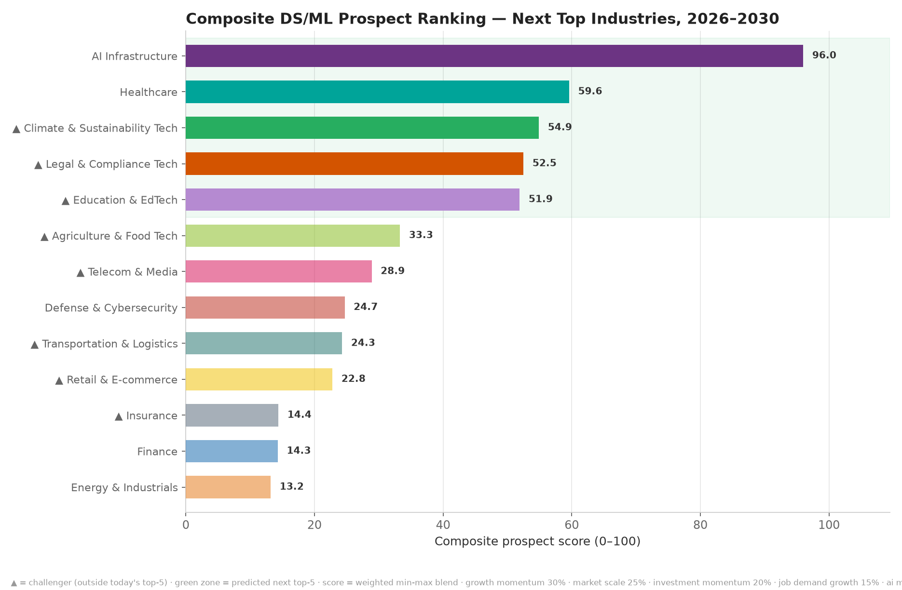
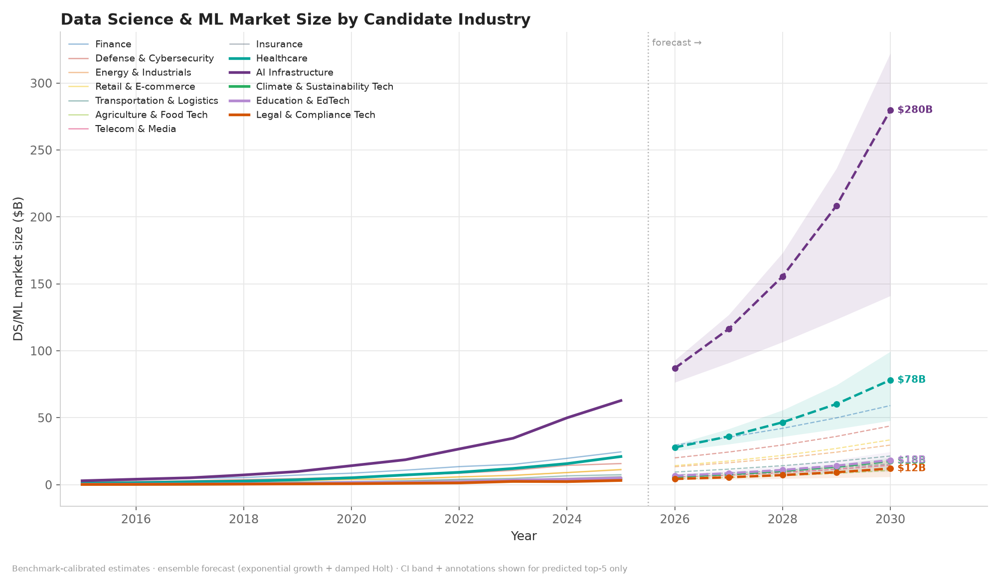
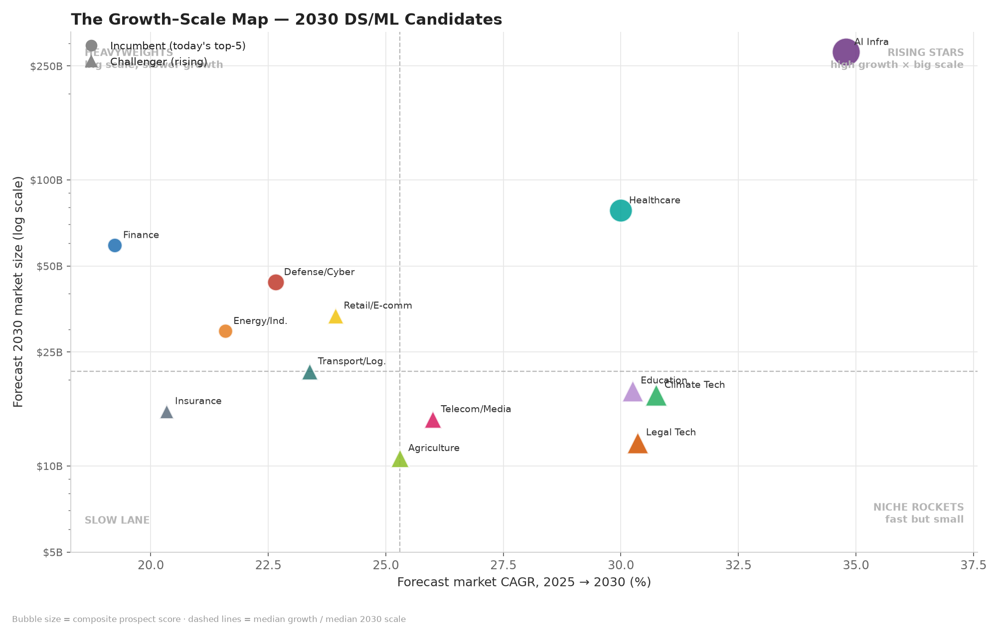
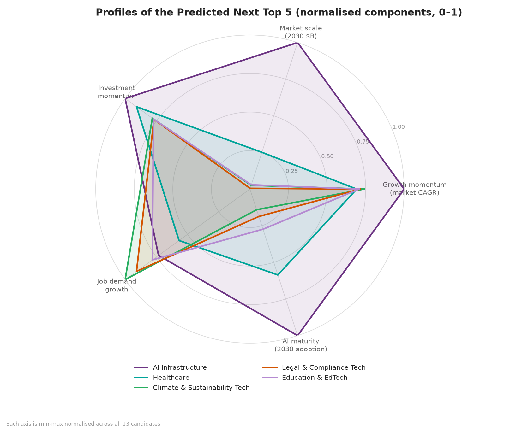

# The NEXT Top Industries for Data Science & Machine Learning

### Beyond today's top-5: a 2026–2030 ranking of 13 candidate industries — who holds, who breaks in

Today's recognised top-5 industries for DS/ML (Healthcare, Finance,
Defense & Cybersecurity, Energy & Industrials, AI Infrastructure) are
treated as **incumbents**. This project adds **eight rising challengers**
— Retail & E-commerce, Transportation & Logistics, Agriculture & Food
Tech, Telecom & Media, Climate & Sustainability Tech, Insurance,
Education & EdTech, and Legal & Compliance Tech — forecasts all 13
candidates to 2030, and ranks them with a transparent composite index to
answer: **which industries rise next, and do any displace the incumbents?**

---

## TL;DR — The predicted NEXT top 5 (2026–2030)

| # | Industry | Tier | Score | 2025 → 2030 market | CAGR |
|---|----------|------|------:|-------------------:|-----:|
| 🥇 1 | **AI Infrastructure** | incumbent | **96.0** | $62.9B → **$279.7B** | **+34.8%** |
| 🥈 2 | **Healthcare** | incumbent | 59.6 | $21.1B → $78.2B | +30.0% |
| 🥉 3 | **Climate & Sustainability Tech** | ▲ challenger | 54.9 | $4.6B → $17.7B | +30.8% |
| 4 | **Legal & Compliance Tech** | ▲ challenger | 52.5 | $3.2B → $12.1B | +30.4% |
| 5 | **Education & EdTech** | ▲ challenger | 51.9 | $4.9B → $18.3B | +30.2% |

**The headline finding: three challengers break into the top 5, displacing
three incumbents.**

- **Holding their spot:** AI Infrastructure, Healthcare
- **Breaking in:** Climate Tech, Legal Tech, Education & EdTech
- **Dropping out:** Defense & Cybersecurity (#8), Finance (#12), Energy & Industrials (#13)

The most instructive case is **Finance**: the *second-largest* 2030 market
($59.1B) drops to **#12** because its growth momentum (+19.2% CAGR) trails
the smaller, faster niches — the classic **momentum-vs-scale trade-off**
that this index deliberately surfaces (full component tables are published
so you can re-weight and re-run).



---

## Key charts

### Market size: history + forecast, all 13 candidates (top-5 emphasised)



### The Growth–Scale Map — every candidate by momentum vs 2030 scale



### Profiles of the predicted next top 5



*(all seven charts live in [`outputs/charts/`](outputs/charts/) — also
investment and job-postings forecasts, and ML adoption S-curves)*

---

## Methodology

```
candidate pool: 13 industries x 2015-2025 panel
   (5 incumbents + 8 challengers)
        │
        ├─▶ ensemble forecast 2026-2030          src/forecast.py
        │     ├─ ExponentialGrowth (OLS on log y ~ t)
        │     ├─ DampedHolt (damped Holt linear trend)
        │     ├─ weights learned by 3-year holdout backtest (∝ 1/MAPE)
        │     └─ 90% CI = mixture bootstrap (1,000 simulated paths)
        │
        ├─▶ logistic S-curve fit for ML adoption  src/forecast.py
        │     (grid-searched ceiling + closed-form logit regression)
        │
        ├─▶ composite prospect index              src/scoring.py
        │     growth 30% · scale 25% · investment 20%
        │     · jobs 15% · adoption 10%  (min-max normalised across 13)
        │
        └─▶ charts + auto-written report         src/visuals.py, src/report.py
```

**Why this model choice?** With ~11 annual observations per series, heavy
models (SARIMA, Prophet, gradient boosting) would overfit. The two-model
ensemble is parsimonious and interpretable; backtesting picks the blend,
and the bootstrap band reflects both model disagreement and noise.

**Full written analysis:** [`outputs/reports/summary_report.md`](outputs/reports/summary_report.md)
— includes the complete 13-industry ranking, forecast tables with 90% CIs,
and an honest limitations section.

---

## Repository structure

```
industry-ml-prospects/
├── main.py                    # end-to-end pipeline (run this)
├── requirements.txt
├── src/
│   ├── data.py                # 13-industry benchmark-calibrated panel builder
│   ├── forecast.py            # ensemble + logistic models
│   ├── scoring.py             # composite prospect index
│   ├── visuals.py             # chart generation (top-5 emphasis)
│   └── report.py              # markdown report writer
├── data/
│   └── industry_panel.csv     # industry × year panel (the dataset)
└── outputs/
    ├── forecasts.csv          # all point forecasts + 90% CI
    ├── scores.csv             # composite scores, tiers & components
    ├── charts/                # 7 publication-ready PNG charts
    └── reports/summary_report.md
```

## Quickstart

```bash
pip install -r requirements.txt
python main.py                                    # full pipeline
python main.py --horizon 8                        # forecast to 2033 instead
python main.py --from-csv data/industry_panel.csv # run on your own panel
```

Adding another candidate industry is **one new entry** in
`INDUSTRY_CALIBRATION` (`src/data.py`) — the whole pipeline re-runs
unchanged.

## Dataset & data honesty

The bundled panel is **benchmark-calibrated synthetic data**: magnitudes,
growth rates, adoption levels and event shocks (the 2020 energy capex dip,
the e-commerce surge, the 2023 GenAI boom in education and legal tech)
are calibrated to published estimates — Grand View Research, Statista /
Precedence, McKinsey *State of AI*, US BLS — so every 2025 value lands
inside the range of public figures.

This is stated plainly because it matters: **the pipeline is
data-agnostic**. Drop a real panel with the same schema into a CSV and run
`--from-csv` and every downstream step (forecasting, scoring, charts,
report) executes unchanged. Swapping in real data is the single
highest-value extension of this project.

## Limitations

- Challenger-pool selection is a judgment call (pool is config-driven and extensible).
- Momentum-weighted scoring favours small, fast bases over big, slow ones — deliberate, and re-weightable.
- Calibrated synthetic inputs (see above) — not scraped primary data.
- ~11 annual points per series → deliberately simple models.
- Bootstrap CIs assume iid innovations and fixed ensemble weights; indicative, not exact.
- Logistic adoption model assumes a stationary saturation ceiling.
- No shock/regulatory scenario modelling (a defence-spending surge or an AI act would move these numbers).
- Sector overlap: AI Infrastructure *supplies* the other sectors, so market figures can double-count.

## References

**Full data-source audit, algorithm names, and paste-ready summary: [`SOURCES.md`](SOURCES.md)**

- Grand View Research — *AI in Healthcare Market*
- Statista / Precedence Research — *AI market size by industry*
- McKinsey — *The State of AI* (annual surveys)
- US Bureau of Labor Statistics — *Data Scientists* occupational outlook
- Gardner & McKenzie (1985) — damped-trend exponential smoothing

---

## Where to find this project

- **Live showcase (Hugging Face Space):** https://danielaxv3-ds-ml-industry-prospects.hf.space
- **GitHub:** https://github.com/danielosinor123-gif/ds-ml-industry-prospects
- **Hugging Face repo:** https://huggingface.co/spaces/danielaxv3/ds-ml-industry-prospects
