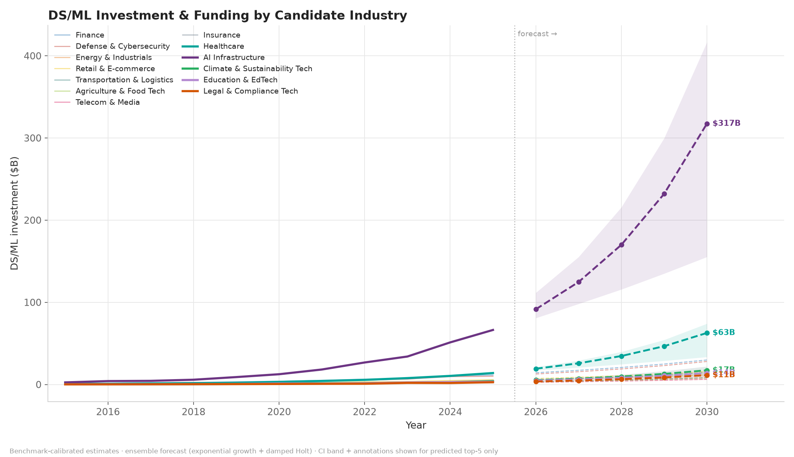
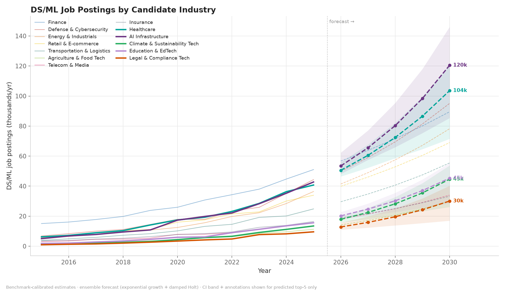
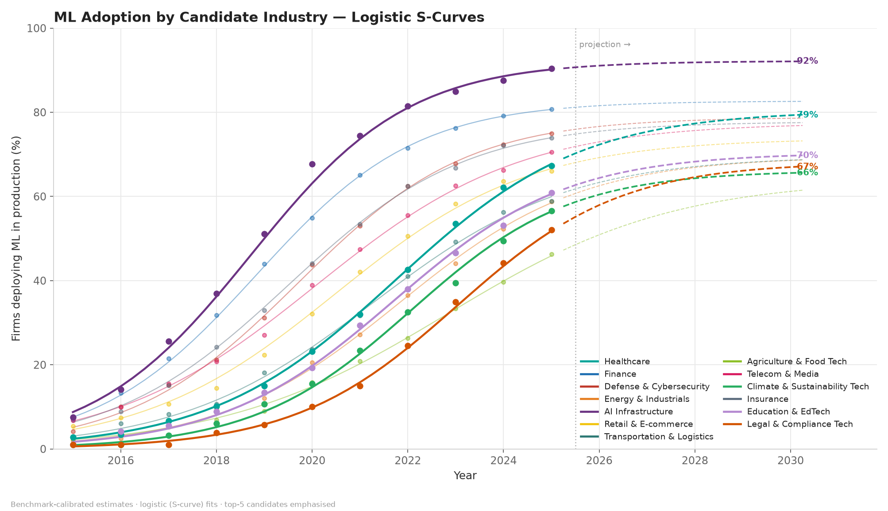

# The NEXT Top Industries for Data Science & Machine Learning
### A 2026–2030 Composite Ranking of 13 Candidate Industries

*Generated automatically by the pipeline in `main.py` · panel covers
2015–2025 · forecast horizon: 5 years ·
5 incumbents vs 8 challengers*

---

## 1. Executive Summary

The predicted **next top-5 industries for DS/ML (2026–2030)**:

1. **AI Infrastructure** — score 96.0
2. **Healthcare** — score 59.6
3. **Climate & Sustainability Tech** — score 54.9
4. **Legal & Compliance Tech** — score 52.5
5. **Education & EdTech** — score 51.9

**Incumbents holding their spot:** **AI Infrastructure**, **Healthcare**
**Challengers breaking in:** **Climate & Sustainability Tech**, **Legal & Compliance Tech**, **Education & EdTech**
**Incumbents dropping out:** **Defense & Cybersecurity**, **Finance**, **Energy & Industrials**

**AI Infrastructure** leads the index with a score of **96.0/100**: its
DS/ML market is projected to grow from $62.9B
(2025) to **$279.7B by 2030** — a
**34.8% CAGR**.

The highest-ranked challenger is **Climate & Sustainability Tech** (#3 overall): its DS/ML market is forecast to grow from $4.6B to $17.7B by 2030 (30.8% CAGR) — out-pacing several larger, more mature incumbents on momentum.

**The question this project answers:** *beyond today's recognised top-5
industries for DS/ML, which industries rise next — and do any of them
displace the incumbents?*

---

## 2. The Candidate Pool

The pool pairs today's recognised top-5 (incumbents, from the original
research list) with eight rising challengers chosen for credible DS/ML
momentum: retail personalisation, logistics optimisation, precision
agriculture, telecom AI, climate analytics, insurtech, edtech and legal AI.

| Industry                      | Tier       | 2025 market | 2025 adoption |
| ----------------------------- | ---------- | ----------- | ------------- |
| AI Infrastructure             | Incumbent  | $62.9B      | 90.4%         |
| Healthcare                    | Incumbent  | $21.1B      | 67.3%         |
| Climate & Sustainability Tech | Challenger | $4.6B       | 56.6%         |
| Legal & Compliance Tech       | Challenger | $3.2B       | 52.1%         |
| Education & EdTech            | Challenger | $4.9B       | 60.9%         |
| Agriculture & Food Tech       | Challenger | $3.4B       | 46.3%         |
| Telecom & Media               | Challenger | $4.6B       | 70.6%         |
| Defense & Cybersecurity       | Incumbent  | $15.8B      | 75.0%         |
| Transportation & Logistics    | Challenger | $7.5B       | 58.9%         |
| Retail & E-commerce           | Challenger | $11.5B      | 66.0%         |
| Insurance                     | Challenger | $6.2B       | 73.9%         |
| Finance                       | Incumbent  | $24.5B      | 80.7%         |
| Energy & Industrials          | Incumbent  | $11.1B      | 58.7%         |

Adding a candidate is a single entry in `INDUSTRY_CALIBRATION`
(`src/data.py`) — the whole pipeline re-runs unchanged.

---

## 3. Methodology

**Data.** An industry × year panel (13 industries ×
11 years, 143 observations)
tracking market size, investment, job postings, ML adoption and patents.
Values are benchmark-calibrated to published estimates (see §12); the
pipeline accepts any real CSV with the same schema via `--from-csv`.

**Forecasting.** Each unbounded metric is forecast with a two-model ensemble:

1. **Exponential growth** — OLS on log(y) ~ t (compound-growth model);
2. **Damped Holt trend** — Holt's linear trend with damping to prevent
   runaway extrapolation.

Model weights are learned by **backtesting on a 3-year holdout** (weight ∝
1/MAPE). The 90% confidence band is a **mixture bootstrap**: 1,000 simulated
paths, each drawn from a component model with probability equal to its
weight. Adoption rates are bounded, so they are fit with a **logistic
S-curve** (grid-searched ceiling, closed-form logit regression).

**Composite scoring.** Components are min-max normalised **across all
13 candidates** and blended:

| Component | Weight |
|---|---|
| Growth momentum (market CAGR) | 30% |
| Market scale (2030 $B) | 25% |
| Investment momentum | 20% |
| Job demand growth | 15% |
| AI maturity (2030 adoption) | 10% |

---

## 4. Full Ranking (2026–2030)

| #  | Industry (tier)                              | Score | Market CAGR | 2030 market | Invest. CAGR | Jobs CAGR | 2030 adoption |
| -- | -------------------------------------------- | ----- | ----------- | ----------- | ------------ | --------- | ------------- |
| 1  | AI Infrastructure (Incumbent)                | 96.0  | 34.8%       | $279.7B     | 36.7%        | 23.0%     | 92.1%         |
| 2  | Healthcare (Incumbent)                       | 59.6  | 30.0%       | $78.2B      | 35.1%        | 20.5%     | 79.3%         |
| 3  | Climate & Sustainability Tech (▲ challenger) | 54.9  | 30.8%       | $17.7B      | 32.7%        | 27.1%     | 65.6%         |
| 4  | Legal & Compliance Tech (▲ challenger)       | 52.5  | 30.4%       | $12.1B      | 32.5%        | 25.7%     | 67.0%         |
| 5  | Education & EdTech (▲ challenger)            | 51.9  | 30.2%       | $18.3B      | 32.6%        | 23.8%     | 69.7%         |
| 6  | Agriculture & Food Tech (▲ challenger)       | 33.3  | 25.3%       | $10.6B      | 29.3%        | 21.6%     | 61.2%         |
| 7  | Telecom & Media (▲ challenger)               | 28.9  | 26.0%       | $14.6B      | 23.2%        | 17.1%     | 76.8%         |
| 8  | Defense & Cybersecurity (Incumbent)          | 24.7  | 22.7%       | $43.9B      | 22.8%        | 16.5%     | 78.6%         |
| 9  | Transportation & Logistics (▲ challenger)    | 24.3  | 23.4%       | $21.4B      | 25.2%        | 17.4%     | 68.6%         |
| 10 | Retail & E-commerce (▲ challenger)           | 22.8  | 23.9%       | $33.5B      | 22.4%        | 15.2%     | 73.1%         |
| 11 | Insurance (▲ challenger)                     | 14.4  | 20.3%       | $15.5B      | 21.4%        | 15.1%     | 77.5%         |
| 12 | Finance (Incumbent)                          | 14.3  | 19.2%       | $59.1B      | 21.0%        | 11.9%     | 82.6%         |
| 13 | Energy & Industrials (Incumbent)             | 13.2  | 21.6%       | $29.6B      | 18.3%        | 16.5%     | 68.6%         |


---

## 5. Market Size Forecasts

| Industry                      | 2025 actual | 2030 forecast | 90% CI              | Implied CAGR |
| ----------------------------- | ----------- | ------------- | ------------------- | ------------ |
| AI Infrastructure             | $62.9B      | $279.7B       | [$141.1B – $322.3B] | 34.8%        |
| Healthcare                    | $21.1B      | $78.2B        | [$47.9B – $99.5B]   | 30.0%        |
| Climate & Sustainability Tech | $4.6B       | $17.7B        | [$10.6B – $20.5B]   | 30.8%        |
| Legal & Compliance Tech       | $3.2B       | $12.1B        | [$5.9B – $18.7B]    | 30.4%        |
| Education & EdTech            | $4.9B       | $18.3B        | [$9.8B – $24.6B]    | 30.2%        |
| Agriculture & Food Tech       | $3.4B       | $10.6B        | [$7.4B – $12.6B]    | 25.3%        |
| Telecom & Media               | $4.6B       | $14.6B        | [$10.7B – $15.6B]   | 26.0%        |
| Defense & Cybersecurity       | $15.8B      | $43.9B        | [$29.3B – $51.9B]   | 22.7%        |
| Transportation & Logistics    | $7.5B       | $21.4B        | [$14.3B – $27.6B]   | 23.4%        |
| Retail & E-commerce           | $11.5B      | $33.5B        | [$23.7B – $43.6B]   | 23.9%        |
| Insurance                     | $6.2B       | $15.5B        | [$12.2B – $19.2B]   | 20.3%        |
| Finance                       | $24.5B      | $59.1B        | [$47.4B – $75.4B]   | 19.2%        |
| Energy & Industrials          | $11.1B      | $29.6B        | [$23.4B – $33.0B]   | 21.6%        |


## 6. Investment & Funding Forecasts

| Industry                      | 2025 actual | 2030 forecast | Implied CAGR |
| ----------------------------- | ----------- | ------------- | ------------ |
| AI Infrastructure             | $66.4B      | $317.4B       | 36.7%        |
| Healthcare                    | $14.0B      | $62.7B        | 35.1%        |
| Climate & Sustainability Tech | $4.2B       | $17.3B        | 32.7%        |
| Legal & Compliance Tech       | $2.8B       | $11.4B        | 32.5%        |
| Education & EdTech            | $3.4B       | $13.9B        | 32.6%        |
| Agriculture & Food Tech       | $2.2B       | $8.1B         | 29.3%        |
| Telecom & Media               | $2.2B       | $6.3B         | 23.2%        |
| Defense & Cybersecurity       | $10.0B      | $28.0B        | 22.8%        |
| Transportation & Logistics    | $4.7B       | $14.5B        | 25.2%        |
| Retail & E-commerce           | $5.8B       | $15.8B        | 22.4%        |
| Insurance                     | $3.2B       | $8.3B         | 21.4%        |
| Finance                       | $11.5B      | $29.8B        | 21.0%        |
| Energy & Industrials          | $5.1B       | $11.8B        | 18.3%        |



## 7. Job Demand Forecasts

| Industry                      | 2025 actual | 2030 forecast | Implied CAGR |
| ----------------------------- | ----------- | ------------- | ------------ |
| AI Infrastructure             | 43k         | 120k          | 23.0%        |
| Healthcare                    | 41k         | 104k          | 20.5%        |
| Climate & Sustainability Tech | 13k         | 45k           | 27.1%        |
| Legal & Compliance Tech       | 10k         | 30k           | 25.7%        |
| Education & EdTech            | 16k         | 45k           | 23.8%        |
| Agriculture & Food Tech       | 11k         | 30k           | 21.6%        |
| Telecom & Media               | 15k         | 34k           | 17.1%        |
| Defense & Cybersecurity       | 44k         | 95k           | 16.5%        |
| Transportation & Logistics    | 25k         | 55k           | 17.4%        |
| Retail & E-commerce           | 34k         | 69k           | 15.2%        |
| Insurance                     | 16k         | 33k           | 15.1%        |
| Finance                       | 51k         | 90k           | 11.9%        |
| Energy & Industrials          | 36k         | 78k           | 16.5%        |



## 8. ML Adoption Projection

| Industry                      | 2025 adoption | 2030 projection | Fitted ceiling | Fit SSE |
| ----------------------------- | ------------- | --------------- | -------------- | ------- |
| AI Infrastructure             | 90.4%         | 92.1%           | 92.2%          | 29.3    |
| Healthcare                    | 67.3%         | 79.3%           | 80.4%          | 3.0     |
| Climate & Sustainability Tech | 56.6%         | 65.6%           | 66.1%          | 13.2    |
| Legal & Compliance Tech       | 52.1%         | 67.0%           | 68.1%          | 4.4     |
| Education & EdTech            | 60.9%         | 69.7%           | 70.4%          | 8.3     |
| Agriculture & Food Tech       | 46.3%         | 61.2%           | 64.1%          | 4.1     |
| Telecom & Media               | 70.6%         | 76.8%           | 77.5%          | 7.7     |
| Defense & Cybersecurity       | 75.0%         | 78.6%           | 78.8%          | 6.8     |
| Transportation & Logistics    | 58.9%         | 68.6%           | 69.6%          | 7.5     |
| Retail & E-commerce           | 66.0%         | 73.1%           | 73.8%          | 11.7    |
| Insurance                     | 73.9%         | 77.5%           | 77.8%          | 6.8     |
| Finance                       | 80.7%         | 82.6%           | 82.7%          | 2.4     |
| Energy & Industrials          | 58.7%         | 68.6%           | 69.5%          | 5.9     |



---

## 9. The Predicted Next Top 5 — Snapshots

- **AI Infrastructure** — rank **#1**, score **96.0**. Strongest dimension: growth momentum (market cagr) (34.8%).
- **Healthcare** — rank **#2**, score **59.6**. Strongest dimension: investment momentum (35.1%).
- **Climate & Sustainability Tech** — rank **#3**, score **54.9** *(challenger breaking in)*. Strongest dimension: job demand growth (27.1%).
- **Legal & Compliance Tech** — rank **#4**, score **52.5** *(challenger breaking in)*. Strongest dimension: job demand growth (25.7%).
- **Education & EdTech** — rank **#5**, score **51.9** *(challenger breaking in)*. Strongest dimension: job demand growth (23.8%).


## 10. Momentum vs Scale — Reading the Trade-off

This index is deliberately **momentum-weighted** (growth 30% + investment
20% + jobs 15% vs scale 25% + adoption 10%). That means smaller-but-faster
niches can outrank larger-but-slower incumbents on *prospect*, which is the
point: "best next opportunity" ≠ "biggest market today". The growth–scale
map makes each candidate's position explicit — bubble size is the composite
score, and the dashed lines split the field into rising stars, heavyweights,
niche rockets and the slow lane.


Because weights are a stated choice, every raw component is published in
§4 — re-weight them to your own view and the ranking re-computes in one
run.

---

## 11. Limitations & Honest Notes

- **Candidate-pool selection is a judgment call.** Eight challengers were
  chosen for credible DS/ML momentum; a different pool yields a different
  ranking. The pool is config-driven and trivially extensible.
- **Momentum-weighting favours small bases.** A 30% CAGR on a $4B market is
  easier than on a $60B market; absolute-scale weightings would lift the
  heavyweights (Finance, Healthcare) relative to niche rockets.
- **Weight sensitivity.** Scores respond to the component weights; the raw
  components are published precisely so a reader can re-weight.
- **Data provenance.** The bundled dataset is *calibrated synthetic data* —
  realistic magnitudes matching public benchmarks, not scraped primary
  sources. Swapping in a real panel (`--from-csv`) is the single
  highest-value improvement.
- **Short series.** ~11 annual points per series limits model complexity;
  the two-model ensemble was chosen for parsimony and interpretability
  over SARIMA/Prophet-style flexibility.
- **Approximate uncertainty.** Bootstrap intervals assume iid innovations
  and treat ensemble weights as fixed; treat them as indicative, not exact.
- **Fixed adoption ceiling.** The logistic model assumes each industry has
  a stationary saturation level; a step-change (e.g. a regulatory shift)
  would invalidate the projection.
- **No shock modelling.** Geopolitical, regulatory or macro shocks
  (e.g. an AI act, a defence-spending surge) are outside the generating
  process of the historical window.
- **Sector overlap.** AI Infrastructure *supplies* the other sectors;
  cross-sector double counting is possible in market-size figures.

## 12. Reproduce / Extend

```bash
pip install -r requirements.txt
python main.py                      # full pipeline (data → report)
python main.py --from-csv data/industry_panel.csv   # use your own data
python main.py --horizon 8 --seed 7                 # different horizon/seed
```

## 13. Calibration References

- Grand View Research — *AI in Healthcare Market* (~$20B+, 2025 est.)
- Statista / Precedence — *AI market by industry* (finance, energy, cyber,
  retail, logistics, insurance, education)
- McKinsey — *The State of AI* surveys (adoption by industry/function)
- US Bureau of Labor Statistics — *Data Scientists* occupational outlook
- Gardner & McKenzie (1985) — damped-trend exponential smoothing
